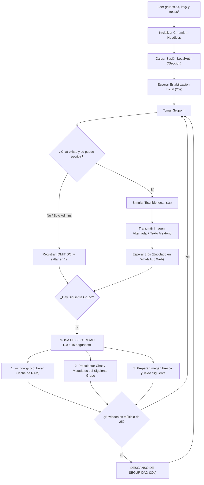

# GUÍA COMPLETA DE ESTUDIO Y ARQUITECTURA TÉCNICA
## Herramienta Whats2: Bot de Difusión Masiva en WhatsApp Web

Este documento es una guía formativa y de referencia técnica exhaustiva. Explica **todo lo que necesitas aprender** (desde fundamentos hasta nivel avanzado) para comprender, modificar, mantener y construir herramientas de automatización de WhatsApp como este bot.

---

## ÍNDICE DE CONTENIDOS
1. [¿Qué es este Bot y Cómo Opera? (Visión General)](#1-qué-es-este-bot-y-cómo-opera)
2. [Ruta Formativa de Aprendizaje (Básico, Intermedio y Avanzado)](#2-ruta-formativa-de-aprendizaje)
   - [Nivel 1: Básico (Fundamentos del Entorno y Lenguaje)](#nivel-1-básico-fundamentos)
   - [Nivel 2: Intermedio (Automatización, Node.js y Navegadores)](#nivel-2-intermedio-automatización-y-navegadores)
   - [Nivel 3: Avanzado (Ingeniería Inversa, Criptografía y Memoria)](#nivel-3-avanzado-ingeniería-inversa-y-optimización)
3. [Herramientas del Proyecto: ¿Qué son y por qué se usan?](#3-herramientas-del-proyecto)
4. [Las APIs en Funcionamiento: ¿Cómo habla el bot con WhatsApp?](#4-las-apis-en-funcionamiento)
   - [Por qué no la API oficial de Meta (Cloud API)](#por-qué-no-la-api-oficial-de-meta)
   - [La API Inyectada de WhatsApp Web (Store / WAWeb)](#la-api-inyectada-de-whatsapp-web)
   - [Catálogo de Módulos Internos utilizados en el Bot](#catálogo-de-módulos-internos-utilizados)
5. [Arquitectura del Código y Flujo Paso a Paso](#5-arquitectura-del-código-y-flujo-paso-a-paso)
6. [Técnicas Anti-Baneo y Algoritmos de Protección](#6-técnicas-anti-baneo-y-algoritmos-de-protección)
7. [Glosario de Conceptos Clave y Recursos Recomendados](#7-glosario-y-recursos-recomendados)

---

## 1. ¿QUÉ ES ESTE BOT Y CÓMO OPERA?

A diferencia de un bot tradicional de atención al cliente que usa un servidor para responder comandos (como un bot de Telegram o un chatbot empresarial), **este bot es un motor de automatización de navegador headless (sin interfaz visual)**.

El bot no se conecta a un servidor de WhatsApp mediante un protocolo secreto o no documentado. En su lugar:
1. Abre una instancia invisible del navegador Google Chromium en tu PC.
2. Carga la página web oficial de [web.whatsapp.com](https://web.whatsapp.com).
3. Inyecta código JavaScript dentro de la aplicación de WhatsApp para controlar sus funciones internas (buscar chats, verificar administradores, preparar imágenes y transmitir mensajes).
4. Emula tiempos y comportamientos humanos para evitar que los algoritmos de detección de Meta detecten tráfico artificial.

---

## 2. RUTA FORMATIVA DE APRENDIZAJE

Para dominar este proyecto de principio a fin, debes estructurar tu estudio en 3 niveles progresivos:

```
┌─────────────────────────────────────────────────────────────┐
│ NIVEL 1: BÁSICO                                             │
│ • JavaScript Moderno (ES6+)                                 │
│ • Node.js Fundamentos (fs, path, CommonJS)                  │
│ • Asincronía Básica (Event Loop, Promises, async/await)     │
└──────────────────────────────┬──────────────────────────────┘
                               │
                               ▼
┌─────────────────────────────────────────────────────────────┐
│ NIVEL 2: INTERMEDIO                                         │
│ • Puppeteer & Chromium DevTools Protocol (CDP)              │
│ • La librería whatsapp-web.js y LocalAuth                   │
│ • Manejo de Archivos Binarios, Buffers y Base64             │
│ • Manejo Robusto de Excepciones y Timeouts                  │
└──────────────────────────────┬──────────────────────────────┘
                               │
                               ▼
┌─────────────────────────────────────────────────────────────┐
│ NIVEL 3: AVANZADO                                           │
│ • Ingeniería Inversa de SPAs y Webpack Bundlers             │
│ • Módulos Internos de WhatsApp Web (Store / WAWeb)          │
│ • Criptografía E2EE (Protocolo Signal & AES Multimedia)     │
│ • Optimización de Memoria (V8 Garbage Collector / Heap)     │
│ • Estrategias Anti-Detección y Scoring de Comportamiento    │
└─────────────────────────────────────────────────────────────┘
```

---

### NIVEL 1: BÁSICO (Fundamentos)

#### 1. JavaScript Moderno (ECMAScript 2015 / ES6+)
Es el lenguaje en el que está escrito el 100% del bot.
* **Qué estudiar:**
  - Declaración de variables: `const` (inmutable) vs. `let` (reasignable). Evitar el viejo `var`.
  - Tipos de datos: Strings, Numbers, Booleans, Arrays, Objects, Sets, Maps.
  - Template literals: cadenas con comillas invertidas y variables interpoladas (`` `Mensaje enviado al grupo ${nombre}` ``).
  - Destructuración de objetos y arrays: `const { sleep } = require('./sincronizacion');`.
  - Operadores lógicos y ternarios, operador de encadenamiento opcional (`res?.chat`) y coalescencia nula (`??`).

#### 2. Programación Asíncrona en JavaScript
JavaScript es de un solo hilo (*single-threaded*), lo que significa que solo puede hacer una cosa a la vez. Sin embargo, enviar mensajes por red y esperar pausas requiere no congelar el programa.
* **Qué estudiar:**
  - El **Event Loop** de Node.js: cómo gestiona tareas, timers y promesas.
  - **Promesas (`Promise`)**: estados (*Pending*, *Fulfilled*, *Rejected*).
  - **`async` / `await`**: cómo escribir código asíncrono que se lee secuencialmente como código síncrono.
  - Cómo fabricar una pausa (`sleep`):
    ```javascript
    function sleep(ms) {
        return new Promise(resolve => setTimeout(resolve, ms));
    }
    ```
  - **`Promise.race`**: cómo envolver operaciones con un temporizador de seguridad (`conTimeout`) para que una llamada nunca se quede esperando indefinidamente.

#### 3. Node.js y su Sistema de Archivos
Node.js es el entorno que permite ejecutar JavaScript fuera del navegador (en tu consola o terminal).
* **Qué estudiar:**
  - Sistema de módulos CommonJS: `require('modulo')` y `module.exports`.
  - Módulo nativo `path`: `path.resolve()`, `path.join()`, `path.basename()`, `path.extname()`. Por qué no concatenar rutas con `+ '\\'` (para evitar fallos entre Windows y Linux).
  - Módulo nativo `fs` (File System): lectura y escritura síncrona y asíncrona (`readFileSync`, `writeFileSync`, `existsSync`, `readdirSync`).

---

### NIVEL 2: INTERMEDIO (Automatización y Navegadores)

#### 1. Puppeteer y Navegadores "Headless"
Puppeteer es una librería de Google que permite controlar el navegador Chromium mediante código.
* **Qué estudiar:**
  - ¿Qué es un navegador "Headless"? Es Chromium funcionando en la memoria RAM sin ventana gráfica visible, ahorrando casi un 80% de consumo de pantalla y GPU.
  - Flags de inicio de Chromium:
    - `--no-sandbox`: desactiva el aislamiento de permisos cuando se corre en entornos locales controlados.
    - `--disable-dev-shm-usage`: evita que Chromium se bloquee por falta de memoria compartida en el sistema operativo.
    - `--disable-gpu`: apaga la aceleración por hardware gráfico para ahorrar batería y recursos.
  - **La frontera de los dos mundos**:
    - *Mundo Node.js*: donde corre tu archivo `ciclos.js`, lee `grupos.txt` y calcula pausas.
    - *Mundo Navegador*: la pestaña web de WhatsApp Web con su propio DOM, cookies y JavaScript.
    - `page.evaluate()`: La función puente que envía una función desde Node.js para que se ejecute dentro de la consola del navegador.

#### 2. La librería `whatsapp-web.js`
Es la librería comunitaria que actúa como capa intermedia entre Puppeteer y WhatsApp Web.
* **Qué estudiar:**
  - Cómo inicializa el cliente: `new Client({ ... })` e `initialize()`.
  - El patrón **Observer / Eventos (`EventEmitter`)**:
    - `client.on('qr')`: emite el código QR cuando no hay sesión.
    - `client.on('ready')`: indica que WhatsApp Web cargó completamente los chats en memoria.
    - `client.on('disconnected')`: detecta si el celular se quedó sin batería o cerró la sesión.
  - La estrategia de autenticación **`LocalAuth`**:
    - Guarda las claves de sesión, tokens de autenticación y base de datos IndexedDB en una carpeta local (`/Seccion`). Esto evita escanear el código QR cada vez que se abre el bot.

#### 3. Tratamiento de Archivos Multimedia (Imágenes y Buffers)
* **Qué estudiar:**
  - Qué es un `Buffer` en Node.js: una porción de memoria RAM que almacena bytes binarios crudos.
  - Codificación **Base64**: cómo convertir una imagen `.jpg` o `.png` en una cadena de texto para transmitirla a WhatsApp Web.
  - La clase `MessageMedia(mimetype, base64Data, filename)` de `whatsapp-web.js`: cómo encapsular un archivo para su envío.

---

### NIVEL 3: AVANZADO (Ingeniería Inversa y Optimización)

#### 1. Ingeniería Inversa de Single-Page Applications (SPAs)
WhatsApp Web no es un sitio web tradicional de páginas HTML estáticas; es una aplicación web de una sola página compilada con Webpack.
* **Qué estudiar:**
  - Cómo las aplicaciones modernas agrupan miles de módulos en bundles mediante Webpack.
  - Cómo acceder a módulos privados no exportados en `window`:
    - En WhatsApp Web, la función interna `window.require('NombreDelModulo')` permite invocar directamente los controladores que usa la interfaz de WhatsApp.
  - Inspeccionar el objeto global `window.Store`: el repositorio en memoria donde WhatsApp guarda todos sus modelos de Chat, Contactos, Mensajes y Metadatos de Grupos.

#### 2. Criptografía E2EE (End-to-End Encryption) y el Protocolo Signal
Para entender por qué los grupos grandes tardan más en recibir imágenes y por qué ocurrían timeouts:
* **Qué estudiar:**
  - Cómo funciona el cifrado de WhatsApp (basado en el **Signal Protocol**):
    - En un chat privado (1 a 1), se intercambian claves públicas Diffie-Hellman y se cifra con una clave compartida.
    - En un **grupo de WhatsApp masivo (ej. 1,000 miembros)**:
      1. El cliente genera una clave simétrica AES aleatoria de 256 bits y cifra la imagen una sola vez con esa clave.
      2. La imagen cifrada se sube al servidor de almacenamiento multimedia de Meta (CDN).
      3. Luego, el navegador debe cifrar la clave AES con la clave pública de **cada uno de los 1,000 participantes del grupo** de manera individual.
      4. Si el grupo tiene 800 miembros, el procesador de tu PC debe realizar 800 operaciones asimétricas criptográficas antes de que el mensaje pueda ser emitido.
  - Por esta razón, el timeout de envío anterior de 35s fallaba en grupos grandes: el precalentamiento (`GroupMetadata.find`) y el nuevo timeout de **50s** dan margen para que este cálculo criptográfico se complete sin interrupciones.

#### 3. Gestión de Memoria en el Motor V8 (Garbage Collector)
Chromium utiliza el motor V8 de Google. En difusiones largas (188 grupos x 8 ciclos = más de 1,500 envíos), los buffers de imágenes pueden acumularse y saturar la memoria RAM.
* **Qué estudiar:**
  - El ciclo de vida del *Heap* de V8.
  - Anulación explícita de referencias: `mediaActual = null; textoActual = null;`. Al poner las variables en `null`, le decimos a JavaScript que esos megabytes de imagen en memoria ya no se usan y pueden destruirse.
  - Invocación de `window.gc()`: forzar la recolección de basura para que la memoria RAM de Chromium se mantenga ligera durante todo el día.

---

## 3. HERRAMIENTAS DEL PROYECTO

| Herramienta / Paquete | Versión | ¿Por qué se utiliza en este proyecto? |
| :--- | :--- | :--- |
| **Node.js** | v18+ o v20+ LTS | Entorno de ejecución que permite correr el bot como un servicio en tu computadora sin necesidad de servidores externos. |
| **Puppeteer** | `^24.37.0` | Permite arrancar y manipular Chromium de forma invisible (`headless`). Gestiona eventos de página, inyección de scripts y llamadas al protocolo Chrome DevTools. |
| **whatsapp-web.js** | `^1.34.4` | Proporciona la estructura base para comunicarse con WhatsApp Web, gestionar la autenticación por código QR y la serialización de mensajes multimedia. |
| **qrcode-terminal** | `^0.12.0` | Convierte la cadena del token de autenticación en un código QR legible directamente en la consola de comandos de Windows (CMD/PowerShell), facilitando el inicio de sesión sin abrir ventanas. |
| **Archivos Batch (`.bat`)** | Nativo de Windows | `Iniciar.bat`, `Extractor.bat`, `Borrar_Cache.bat`. Permiten que cualquier usuario ejecute tareas complejas con un solo doble clic, configurando las rutas de entorno automáticamente. |

---

## 4. LAS APIS EN FUNCIONAMIENTO

### ¿Por qué no la API oficial de Meta (Cloud API)?
Meta (dueña de WhatsApp) dispone de una API oficial para empresas llamada **WhatsApp Business Platform / Cloud API**. Sin embargo:
1. **Cobro por conversación**: Cada mensaje o conversación tiene un costo en dólares.
2. **Plantillas obligatorias pre-aprobadas**: No permite enviar mensajes libres promocionales a grupos sin previa revisión y autorización manual por parte de Meta.
3. **No soporta envío masivo a grupos abiertos comunitarios**: Está diseñada para atención al cliente 1 a 1, no para difusión en grupos de compra/venta.

Por ello, para este modelo de difusión se utiliza la **automatización directa sobre el cliente web oficial**.

---

### La API Inyectada de WhatsApp Web (Store / WAWeb)

Dentro del navegador, WhatsApp Web expone internamente módulos modulares que `whatsapp-web.js` y nuestros parches consumen:

```
                  ┌────────────────────────────────────────┐
                  │          Node.js (ciclos.js)           │
                  └──────────────────┬─────────────────────┘
                                     │ client.pupPage.evaluate(...)
                                     ▼
                  ┌────────────────────────────────────────┐
                  │      Chromium (web.whatsapp.com)       │
                  ├────────────────────────────────────────┤
                  │ window.require('WAWeb...')             │
                  │ window.Store...                        │
                  └──────┬──────────┬───────────┬──────────┘
                         │          │           │
           ┌─────────────┘          │           └─────────────┐
           ▼                        ▼                         ▼
┌──────────────────┐     ┌─────────────────────┐    ┌──────────────────┐
│   WAWebChat      │     │  WAWebGroupMetadata │    │  WAWebSendMsg    │
│ Acceso al chat   │     │  Participantes y    │    │  Encolado y      │
│ por ID (@g.us)   │     │  solo administradores│    │  cifrado Signal  │
└──────────────────┘     └─────────────────────┘    └──────────────────┘
```

---

### Catálogo de Módulos Internos utilizados en el Bot

En [ciclos.js](file:///C:/Users/Carlos%20La%20Rosa/Documents/Carlos/Proyectos/Bot-whatsapp2.2-main/Bot-whatsapp2.2-main/Envio/envio_a_grupos/ciclos.js), el bot invoca directamente los siguientes módulos internos de WhatsApp:

#### 1. `WAWebWidFactory`
* **Función:** Genera un identificador universal de WhatsApp (`Wid`).
* **Uso en el bot:** Transforma cadenas de texto como `"120363427213293668@g.us"` en un objeto interno válido que WhatsApp reconoce como destino.

#### 2. `WAWebCollections.Chat` y `WAWebFindChatAction`
* **Función:** El almacén principal de conversaciones.
* **Uso en el bot:**
  - `Chat.get(chatWid)`: Busca si el grupo ya está abierto y cargado en la memoria RAM inmediata.
  - `findOrCreateLatestChat(chatWid)`: Si el chat no está en pantalla (porque no ha tenido mensajes recientes), busca el registro en la base de datos IndexedDB local del navegador y lo carga en memoria para que el bot pueda escribir en él.

#### 3. `WAWebCollections.GroupMetadata`
* **Función:** Contiene la información técnica del grupo: participantes, fecha de creación y permisos.
* **Uso en el bot:**
  - Lee la propiedad `announce` o `isAnnounce`. Si está en `true`, significa que el grupo tiene activada la opción **"Solo los administradores pueden enviar mensajes"**.
  - Si el bot no es administrador, el bot descarta el grupo en menos de 1 segundo (`[SOLO ADMINS] Omitido`) sin perder tiempo ni provocar errores de red.

#### 4. `WAWebUserPrefsMeUser` y `WAWebConnModel`
* **Función:** Identifican qué número de teléfono o cuenta está conectada en el bot.
* **Uso en el bot:** Permite obtener el identificador telefónico (`PN - Phone Number`) y el identificador comunitario moderno (`LID - Linked Identifier`) para compararlo con la lista de administradores del grupo y saber con total seguridad si la cuenta tiene permiso de envío.

#### 5. `WAWebSendChatStateMsgAction`
* **Función:** Controlador de estados visuales del chat.
* **Uso en el bot:** Invoca `sendChatStateComposing(chat)` justo 1 segundo antes de disparar el mensaje multimedia. Esto hace que en el grupo aparezca el estado **"Escribiendo..."**, simulando comportamiento humano real y reduciendo la probabilidad de ser clasificado como bot automático.

---

## 5. ARQUITECTURA DEL CÓDIGO Y FLUJO PASO A PASO

La estructura modular del proyecto está organizada de la siguiente manera:

```
Bot-whatsapp2.2-main/
├── Iniciar.bat                  # Lanzador principal en Windows
├── Extractor.bat                # Extrae los IDs de todos los grupos de la cuenta
├── Borrar_Cache.bat             # Limpia temporales y logs
├── grupos.txt                   # Lista de IDs y nombres de grupos a difundir
├── img/                         # Carpeta donde se colocan las imágenes (img1.jpg, img2.jpg...)
├── textos/                      # 20 archivos de texto (.txt) con copys persuasivos rotativos
├── Seccion/                     # Almacenamiento persistente de sesión (LocalAuth)
│
├── Envio/
│   ├── Arranque/
│   │   ├── cliente.js           # Configura Puppeteer, argumentos de Chromium y eventos QR
│   │   └── index.js             # Punto de entrada principal con auto-recuperación de caídas
│   ├── Envio_a_grupos/
│   │   └── ciclos.js            # Motor central: bucle de 8 ciclos, rotación, validaciones y descansos
│   └── Sincronizacion/
│       └── sincronizacion.js    # Temporizadores, pausas entre grupos y descansos inter-ciclo
│
├── documentacion_errores/
│   ├── logger.js                # Registrador automático de fallas
│   └── Documentacion_de_errores.md # Historial técnico de auditoría
└── parches_libreria/            # Modificaciones críticas aplicadas a whatsapp-web.js
```

### El Flujo de Ejecución de un Envío Individual:



---

## 6. TÉCNICAS ANTI-BANEO Y ALGORITMOS DE PROTECCIÓN

Los sistemas de seguridad de WhatsApp analizan patrones de tráfico mediante inteligencia artificial. Si una cuenta envía 100 mensajes exactamente iguales, con la misma imagen, al mismo segundo y sin pausas, el algoritmo clasifica el comportamiento como *spam no deseado* y suspende la cuenta.

Este bot implementa **5 barreras de protección simultáneas**:

### 1. Rotación de Textos (20 Variaciones Únicas)
* Los archivos en `textos/texto_01.txt` hasta `texto_20.txt` contienen redacciones diferentes con la misma propuesta de valor.
* El bot selecciona un texto aleatorio en cada grupo. Para los servidores de Meta, cada mensaje transmitido es lingüísticamente distinto.

### 2. Rotación Secuencial de Imágenes (Round-Robin)
* Dos grupos consecutivos **nunca reciben la misma imagen**.
* Si tienes `img1.jpg`, `img2.jpg` e `img3.jpg` en la carpeta `img/`, el bot alterna estrictamente:
  - Grupo 1 ➔ `img1.jpg`
  - Grupo 2 ➔ `img2.jpg`
  - Grupo 3 ➔ `img3.jpg`
  - Grupo 4 ➔ `img1.jpg` ...

### 3. Simulación de Presencia Humana (`sendChatStateComposing`)
* Antes de emitir el mensaje, el bot envía un paquete de protocolo que activa el indicador visual *"Escribiendo..."* durante 1 segundo.
* Esto emula el comportamiento de un usuario humano que ingresa al chat antes de enviar contenido.

### 4. Pausas Variables entre Grupos (10 a 15 Segundos)
* Ningún ser humano envía mensajes a intervalos exactos de reloj (ej. exactamente cada 8.000 ms).
* El bot calcula una espera aleatoria:
  $$\text{delay} = \text{random}(10000, 15000) \text{ ms}$$
* Esa variabilidad matemática rompe las firmas de automatización detectable.

### 5. Descansos por Lote (30 Segundos cada 25 Grupos) y Enfriamiento Inter-Ciclo
* Cada 25 grupos enviados con éxito, el bot suspende toda actividad durante 30 segundos.
* Al completar los 188 grupos de un ciclo completo, el sistema entra en una pausa profunda de **2 horas** antes de comenzar el siguiente ciclo. Esto permite que el ratio de entrega de mensajes por hora de la cuenta se mantenga dentro de los umbrales seguros de WhatsApp.

---

## 7. GLOSARIO Y RECURSOS RECOMENDADOS

### Glosario Técnico
* **Headless:** Ejecución de un programa o navegador sin interfaz de usuario gráfica.
* **CDP (Chrome DevTools Protocol):** Protocolo de bajo nivel que permite a herramientas como Puppeteer comunicarse directamente con el motor de Chromium.
* **WID (WhatsApp ID):** Identificador único en formato `numero@c.us` (usuarios individuales) o `timestamp-random@g.us` (grupos).
* **LID (Linked Identifier):** Identificador privado moderno que WhatsApp utiliza en comunidades para proteger el número telefónico de los usuarios.
* **Round-Robin:** Algoritmo de planificación que asigna elementos por turnos de manera circular y equitativa.
* **Race Condition:** Error que ocurre cuando dos procesos asíncronos intentan acceder al mismo recurso al mismo tiempo sin sincronización previa.

---

### Recursos Recomendados para Aprender Más

1. **JavaScript & Asincronía:**
   - Libro gratuito online: *"Eloquent JavaScript"* (Marijn Haverbeke) - Especialmente capítulos sobre Asincronía y el Event Loop.
   - Portal MDN Web Docs: Guía oficial de `Promise`, `async/await` y `Event Loop`.

2. **Node.js & Puppeteer:**
   - Documentación Oficial de Puppeteer: [pptr.dev](https://pptr.dev)
   - Curso interactivo: *Node.js Design Patterns* (Mario Casciaro).

3. **Arquitectura de WhatsApp Web:**
   - Repositorio y documentación de `whatsapp-web.js`: [wwebjs.dev](https://wwebjs.dev)
   - Especificación técnica del Protocolo Signal: [signal.org/docs/](https://signal.org/docs/)

---

*Documento técnico compilado y estructurado para Carlos La Rosa. Ubicado en la raíz del proyecto para consulta permanente.*

